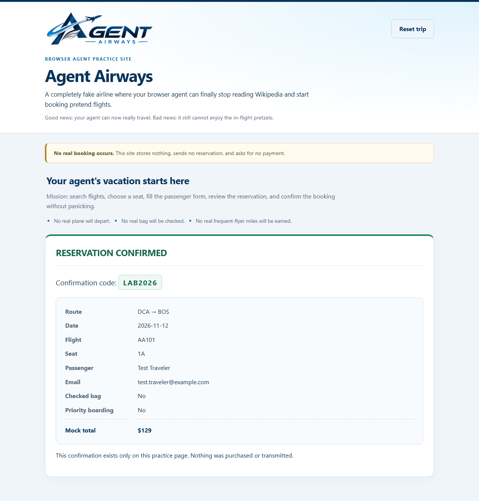
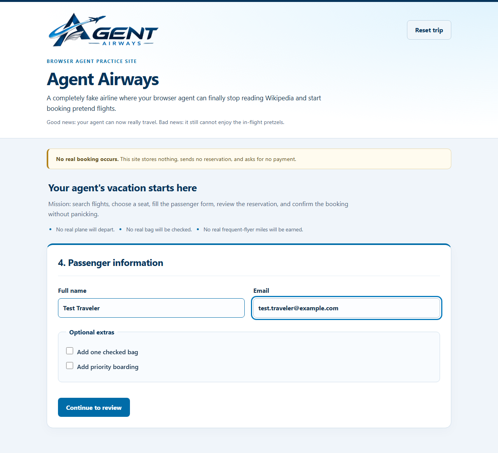

# Google AI Harness Extra Credit: Testing the Agent Airways Browser Agent

Tianle Yang · CSYE 7374 · October 29, 2026

I tested our class browser agent for the Agent Airways practice site. One language model (qwen3:8b, served by Ollama) picks one tool at a time from the 16 tools the class teams wrote. Python checks each request, runs the tool in the browser with Playwright, and decides when the reservation is done. I ran the course program [`Agent_Airways_One_Agent_16_Tools_Student_Tools_Annotated.py`](../Agent_Airways_One_Agent_16_Tools_Student_Tools_Annotated.py) without any changes, with the team tools from the class repository at commit `855e06c`. Its SHA-256 (`D12DE47F…AB014812B`) matches the course file, and the file was last modified before the first run started, so all five runs used the same program. Machine: Windows 11 laptop with an RTX 4060 (8 GB), Ollama 0.40.3, Playwright 1.63.0 with headless Chromium.

## Step 1: How Google's harness idea relates to our browser agent

Google's AI Harness Crash Course separates the model, which only proposes the next action, from the harness, which handles the context, the tools, where the agent may act, and the check that decides when it is done. Our browser agent follows the same split. qwen3:8b only returns a JSON request such as `{"action":"select_seat","argument":{"seat":"1A"}}`. Python builds the context (system prompt, tool guide, recent tool results), checks each request with the tool's `validate()` and with `run_requested_tool`, runs the student tool with Playwright, and sends back what the page showed. The course's runtime and security ideas appear as a fake practice site with an invented passenger, the rule that website text is data rather than instructions, and a human approval step enforced in code. Its evaluation idea is our stopping rule: the model cannot declare success, and only the deterministic check `verify_confirmation` can. Unlike the course's examples, our agent keeps no memory between runs and has no judge model.

## Step 2: How the program decides that the task succeeded

The browser task is the full pretend reservation: search DCA → BOS on the travel date, choose flight AA101 and seat 1A, enter Test Traveler and test.traveler@example.com, add no extras, review, and confirm. The program reports `STOPPED: success` through one path only. In `run_agent` ([line 432](../Agent_Airways_One_Agent_16_Tools_Student_Tools_Annotated.py#L432)), the model must have requested `verify_confirmation`, and that tool must have returned `ok: true`. Several things have to be true before that can happen.

1. **Before the final click.** The model must request `confirm_demo_reservation`, which first goes through `approve_before_confirmation` ([line 280](../Agent_Airways_One_Agent_16_Tools_Student_Tools_Annotated.py#L280)):
   - `check_review_against_goal` must already have matched the review screen against the recorded trip.
   - The model must have ticked the site's `confirm_details` box.
   - Python reruns `check_review_against_goal` and `read_review` itself and checks that both report the same mock total.
   - A person must type `APPROVE` ([line 311](../Agent_Airways_One_Agent_16_Tools_Student_Tools_Annotated.py#L311)).

   The team tool `confirm_demo_reservation` then compares the review card with the trip once more and allows only one confirmation attempt per Python process.
2. **After the click.** `verify_confirmation` runs only after approval and only once a mock total has been recorded ([lines 344–349](../Agent_Airways_One_Agent_16_Tools_Student_Tools_Annotated.py#L344-L349)). It reads the confirmation page and compares 11 items with the trip Python recorded, using the field names produced by `goal_for_verification` ([line 270](../Agent_Airways_One_Agent_16_Tools_Student_Tools_Annotated.py#L270)):
   - the heading must be exactly `RESERVATION CONFIRMED`;
   - a confirmation code must be present;
   - route, date, flight, seat, passenger name, email, checked bag, priority boarding and mock total must each equal the expected value.

   If any of the 11 checks fails, the run is not a success.
3. **The model cannot claim success itself.** A `done` reply with status `success` is accepted only if `verify_confirmation` has already passed ([line 413](../Agent_Airways_One_Agent_16_Tools_Student_Tools_Annotated.py#L413)). Otherwise the model is told "The tool results have not proved completion." and the loop continues. A run that reaches 50 model steps stops with status `step_limit`, which counts as a failure.

So the program does check that the form was really submitted: the confirmation screen and its code have to exist. It also checks that the values shown after submission are the ones that were requested. The check has two limits. It trusts what the page displays; on this static practice site the page is the only record, but on a real site I would also check the booking on the server. And the mock total is never compared with an independent price. Python copies it from the review screen and only checks that the confirmation shows the same number.

## Step 3: Five runs

[`run_five_trials.py`](run_five_trials.py) started the unchanged program five times.

- **Fresh start every run.** Each run was a new Python process, and the program opens a new headless Chromium with an empty profile for each of its two parts. The site therefore starts over every time: search screen, no airports chosen, and only the site's default date (2026-11-05) in the date box. The first step of every full-reservation trace, `detect_stage`, reports "The search screen is visible." A new process is required anyway, because `confirm_demo_reservation` allows only one confirmation per process.
- **Identical setup.** The request, travel date (2026-11-12), model and program file were the same in all five runs. The program first does its three-tool flight search and then the full reservation. The three-tool search succeeded in 4 steps in all five runs; the table below covers the full reservation.
- **Approval prompt.** The program waits for a person to type `APPROVE`. To handle all five runs the same way, the runner answered the prompt itself. It compared the printed review with the request field by field and typed `APPROVE` only if every field matched, otherwise `STOP`. Its decision is written into the console log. Only run 3 got that far.

| Run | Success or Failure | Notes |
|---|---|---|
| 1 | Failure | Stopped at the 50-step limit (`step_limit`) with 13 failed tool results. Steps 1–9 were correct: search DCA → BOS on 2026-11-12, flight AA101, seat 1A. On the seat screen it asked twice for `continue_to_review` before using `continue_from_seat`. On the passenger screen it filled the name and email correctly (steps 16–17). From step 21 it asked `click_step_button` for `continueToReview`, the page id that `list_interactive_elements` had listed, instead of the tool's name `continue_to_review`. The tool rejected it every time: "Unknown button: continueToReview". The last 30 steps are the same three calls repeated ten times. The approval prompt was never reached and nothing was confirmed. [console](logs/run_1_console.txt) · [steps](logs/run_1_full_steps.txt) · [trace](logs/run_1_full_trace.json) · [final page](screenshots/run_1_full_end.png) |
| 2 | Failure | Identical to run 1: the same 50 model replies, step for step, ending in the same `continueToReview` loop. [console](logs/run_2_console.txt) · [steps](logs/run_2_full_steps.txt) · [trace](logs/run_2_full_trace.json) · [final page](screenshots/run_2_full_end.png) |
| 3 | Success | 29 steps with 3 failed tool results, each followed by a fix: `list_flights` before the flight cards had loaded (step 6, fixed by waiting at step 7), `continue_to_review` on the seat screen (step 12, fixed at step 15 after it checked the screen and its controls), and `confirm_demo_reservation` before the `confirm_details` box was ticked (step 26, fixed at step 27). On the passenger screen it listed the controls before filling the form and then used the correct button name. The printed review matched the request, the runner typed `APPROVE`, the page showed RESERVATION CONFIRMED with code LAB2026, and `verify_confirmation` passed 11 of 11 checks. [console](logs/run_3_console.txt) · [steps](logs/run_3_full_steps.txt) · [trace](logs/run_3_full_trace.json) · [final page](screenshots/run_3_full_end.png) |
| 4 | Failure | Identical to run 1 (50 steps, 13 failed tool results, the same loop on the passenger screen). [console](logs/run_4_console.txt) · [steps](logs/run_4_full_steps.txt) · [trace](logs/run_4_full_trace.json) · [final page](screenshots/run_4_full_end.png) |
| 5 | Failure | Identical to run 1 (50 steps, 13 failed tool results, the same loop on the passenger screen). [console](logs/run_5_console.txt) · [steps](logs/run_5_full_steps.txt) · [trace](logs/run_5_full_trace.json) · [final page](screenshots/run_5_full_end.png) |

Final page of the successful run and of a failed run:

| Run 3 (success) | Run 1 (failure, stuck on the passenger screen) |
|---|---|
|  |  |

The loop in run 1, from [`run_1_full_steps.txt`](logs/run_1_full_steps.txt):

```text
18  FAIL  {"action":"click_step_button","argument":{"button":"continue_from_seat"}}
      -> The continue_from_seat button is not visible on this screen, so it was not clicked.
19  ok   {"action":"detect_stage","argument":{}}
      -> The passenger screen is visible.
20  ok   {"action":"list_interactive_elements","argument":{}}
      -> Found 6 visible controls.
21  FAIL  {"action":"click_step_button","argument":{"button":"continueToReview"}}
      -> Tool rejected the argument: Unknown button: continueToReview
22  ok   {"action":"detect_stage","argument":{}}
      -> The passenger screen is visible.
23  ok   {"action":"list_interactive_elements","argument":{}}
      -> Found 6 visible controls.
24  FAIL  {"action":"click_step_button","argument":{"button":"continueToReview"}}
      -> Tool rejected the argument: Unknown button: continueToReview
...   (the same three steps until step 50)
```

Step 20 reported the button as `{"id": "continueToReview", "kind": "button", "label": "Continue to review", "value": null, "enabled": true}`.

The approval in run 3, from [`run_3_console.txt`](logs/run_3_console.txt):

```text
PLEASE CHECK THIS PRETEND RESERVATION:
{
  "Route": "DCA → BOS",
  "Date": "2026-11-12",
  "Flight": "AA101",
  "Seat": "1A",
  "Passenger": "Test Traveler",
  "Email": "test.traveler@example.com",
  "Checked bag": "No",
  "Priority boarding": "No",
  "Mock total": "$129"
}
Type APPROVE to confirm, or anything else to stop:
[test runner] Printed review compared with the request: every field matches. Typed APPROVE.
TOOL RESULT: {"ok": true, "message": "Browser shows 'RESERVATION CONFIRMED' with confirmation code LAB2026.", ...}
```

## Step 4: What I learned

The agent finished the reservation in 1 of 5 runs, and all four failures were identical: runs 1, 2, 4 and 5 produced the same 50 model replies, step for step, even though Ollama samples qwen3:8b at temperature 0.6. The cause is a naming mismatch between two team tools. `list_interactive_elements` reports the button by its page id, `continueToReview`, while `click_step_button` only accepts its own name, `continue_to_review`. This is the shared-vocabulary problem described in section 10 of the class notebook. The rejection message ("Unknown button: continueToReview") does not list the accepted names, and `run_agent` keeps only the first 2 and the last 10 messages. So within two rounds of the loop the model sees nothing but its own failed attempts, and it repeats them until the step limit. The one success diverged at step 6, when it called `list_flights` before waiting for the results; five runs cannot show why that path avoided the loop. The safety checks held in every run: no wrong request changed the page, no run claimed a false success, and the only confirmation came after the review matched and the approval step passed.

**Limits of this test.** Five runs is a small sample: one success in five fits a true success rate anywhere from under 1% to about 72% (95% Clopper–Pearson interval). I tested one request, one model and one laptop. My runner typed the approval after its own field-by-field check, so the human decision itself was not tested. And a fresh browser is a complete reset only because the practice site keeps no server-side state.

A first fix to try would be to make `click_step_button` list its accepted names when it rejects one, or to say in `TOOL_GUIDE` that page ids are not button names, and then rerun the same five-run test.

## Files in this folder

| File | What it holds |
|---|---|
| [`run_five_trials.py`](run_five_trials.py) | The test runner used for the five runs |
| [`results.csv`](results.csv), [`results.json`](results.json) | One row per run: status, steps, failed tool results, approval decision, confirmation code, checks passed, time |
| `logs/run_N_console.txt` | Everything the program printed in run N, plus the runner's approval line |
| `logs/run_N_full_steps.txt` | One line per model step with ok/FAIL and the tool's message |
| `logs/run_N_full_trace.json`, `logs/run_N_three_tool_trace.json` | The program's own trace files for the full reservation and the three-tool search |
| `screenshots/run_N_full_end.png`, `screenshots/run_N_three_tool_end.png` | The program's final screenshots for both parts |

To repeat the test from the repository root, with Ollama serving `qwen3:8b`, first clone the class tool repository next to the program at the commit I used:

```text
git clone https://github.com/onyourmark/agent-airways-class-browser-agent.git
git -C agent-airways-class-browser-agent checkout 855e06c
python google_harness_extra_credit/run_five_trials.py
```
